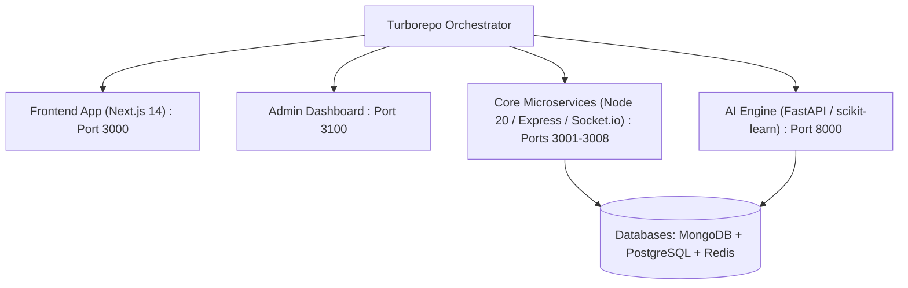

# 🏫 CampusOS TITAN X: Unified AI Campus Infrastructure

[](#)
[](#)
[](#)
[](#)
[](https://opensource.org/licenses/MIT)

> **CampusOS TITAN X** is a unified, AI-powered campus infrastructure platform that transforms university environments into a self-sustaining digital micro-economy. Built as a high-fidelity startup command center integrating student marketplaces, gig logistics, hostel ERP, and fintech escrow.

---

## 🌐 Ecosystem Overview

- 🛍️ **Campus Marketplace:** P2P student marketplace for second-hand textbooks, electronics, and lab equipment.
- 📦 **Gig Logistics:** On-demand peer-to-peer campus delivery network built by students for students.
- 💡 **SkillSwap:** Freelance talent marketplace for tutoring, UI/UX design, and coding assistance with escrow payouts.
- 🏠 **Hostel & Housing ERP:** Student accommodation booking, rent collection, and facility maintenance dispatch.
- 🍲 **Smart Food Canteen:** Mobile order-ahead meal queues and digital mess hall subscriptions.
- 💬 **Campus Social:** Real-time social feed, departmental channels, and live event coordination.
- 💳 **Fintech Escrow:** Dual-currency wallet (Campus Coins & INR) with secure escrow dispute handling.

---

## 🏗️ Monorepo Architecture

Engineered as a production-grade monorepo powered by **Turborepo** and **pnpm**:



- **Frontend:** Next.js 14, Tailwind CSS, Dark Mode Glassmorphism UI.
- **Backend Services:** Node.js 20, Express, Socket.IO real-time channels.
- **AI Core:** Python FastAPI, scikit-learn recommendation and pricing models.
- **Data Tier:** MongoDB (documents), PostgreSQL (financial ledger), Redis (caching).
- **Orchestration:** Docker Compose multi-container deployment.

---

## 🚀 Getting Started

### Prerequisites
- [Node.js 20+](https://nodejs.org/)
- [pnpm 8+](https://pnpm.io/) (`npm install -g pnpm`)
- [Docker & Docker Compose](https://www.docker.com/)
- [Python 3.11+](https://www.python.org/) (for the AI Engine)

### 1. Installation

```bash
# Clone the repository
git clone https://github.com/avrojitsaha763-byte/campusOS.git
cd campusOS

# Install monorepo dependencies
pnpm install
```

### 2. Configure Environment

```bash
cp .env.example .env.local
```

### 3. Launch Services

```bash
# Start background database containers
pnpm run docker:up

# Start all monorepo microservices in parallel
pnpm run dev
```

The unified ecosystem will be running across the following ports:
- **Student Web App:** `http://localhost:3000`
- **Campus Admin Console:** `http://localhost:3100`
- **Core API Microservices:** `http://localhost:3001` through `http://localhost:3008`
- **AI Recommendation Engine:** `http://localhost:8000`

---

## 📂 Monorepo Structure

```text
├── apps/
│   ├── web/                    # Student-facing Next.js portal
│   └── admin/                  # Administrative operations console
├── services/                   # Node.js backend microservices (3001-3008)
├── packages/                   # Shared UI components, configs, and utilities
├── docker-compose.yml          # Container configuration for DBs and services
├── turbo.json                  # Turborepo task pipeline definition
└── pnpm-workspace.yaml         # Workspace package resolution
```

---

## 📄 License

Distributed under the MIT License. Developed by **[Avrojit Saha](https://github.com/avrojitsaha763-byte)**.
